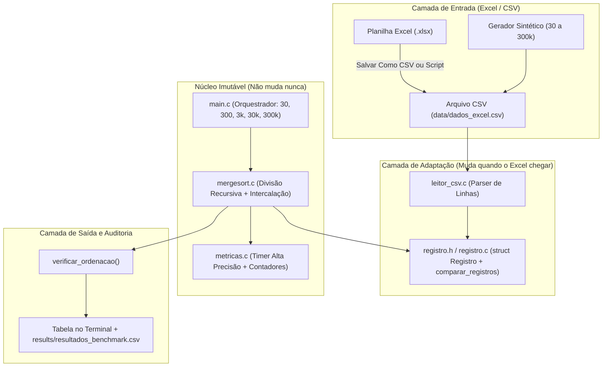
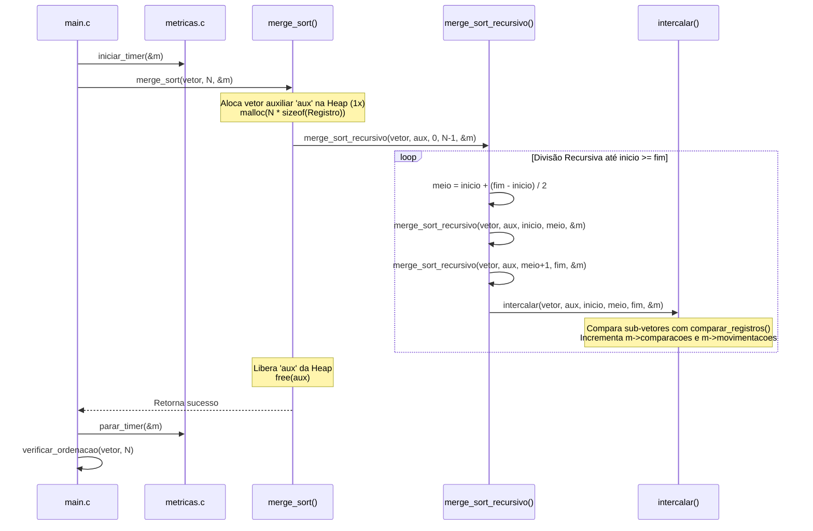

# Arquitetura do Sistema — Merge Sort Recursivo em C

> **Propósito:** Documentar a organização modular, o fluxo de dados, o gerenciamento de memória e o padrão de adaptação para planilhas Excel do projeto de Estrutura de Dados (4ª Fase).

---

## 1. Princípios Arquiteturais

1. **Simplicidade Acadêmica (KISS):** Usar apenas a biblioteca padrão da linguagem C (`<stdio.h>`, `<stdlib.h>`, `<string.h>`, `<time.h>`) e API nativa de tempo do sistema operacional, garantindo compilação imediata com um único comando `gcc`.
2. **Desacoplamento de Dados (Adapter Pattern em C):** O algoritmo `mergesort.c` desconhece o formato da planilha Excel. Ele opera exclusivamente sobre o tipo abstrato `Registro` e a função `comparar_registros()`.
3. **Segurança de Memória em Larga Escala (300.000 registros):** Vetores de dados e buffers auxiliares são alocados na **Heap** (`malloc`/`free`), prevenindo estouro de pilha (*Stack Overflow*).
4. **Alocação Única de Buffer Auxiliar:** Em vez de chamar `malloc()` e `free()` dentro de cada uma das $2N - 1$ chamadas recursivas da função `intercalar()`, o vetor auxiliar `aux` de tamanho $N$ é alocado **uma única vez** no início do `merge_sort()` e reutilizado em todas as chamadas recursivas. Isso mantém a recursividade 100% pura e evita gargalos de sistema operacional.

---

## 2. Estrutura de Diretórios

```text
Trabalho Estrutura de Dados/
├── include/                      # Arquivos de cabeçalho (.h) - Contratos e structs
│   ├── registro.h                # Definição da struct Registro (colunas do Excel) e comparação
│   ├── mergesort.h               # Protótipos do Merge Sort Recursivo e validador
│   ├── metricas.h                # Struct Metricas e Timer de alta precisão
│   └── leitor_csv.h              # Leitor de arquivos CSV/Excel e gerador de testes
│
├── src/                          # Implementações (.c)
│   ├── main.c                    # Menu interativo e orquestrador das 5 baterias (30 a 300k)
│   ├── registro.c                # Função comparar_registros() e impressão de linha
│   ├── mergesort.c               # Implementação didática do Merge Sort Recursivo
│   ├── metricas.c                # Cronômetro de alta resolução e formatação de tabela
│   └── leitor_csv.c              # Parser de CSV flexível (',' ou ';') e gerador de massa
│
├── data/                         # Arquivos de entrada (Planilhas convertidas e geradas)
│   ├── dados_excel.csv           # Planilha oficial exportada do Excel
│   └── generated/                # Dados sintéticos para testes (30 a 300.000 linhas)
│
├── results/                      # Saída dos experimentos
│   └── resultados_benchmark.csv  # Tabela de tempos gerada pelo programa (pronta p/ gráfico no Excel)
│
├── scripts/                      # Utilitários opcionais
│   └── excel_para_csv.py         # Script opcional para converter .xlsx -> .csv automaticamente
│
├── Makefile                      # Automação de compilação (make / mingw32-make)
├── compilar.bat                  # Script de 1 clique para compilar e rodar no Windows
├── PLANO_DE_EXECUCAO.md          # Plano diretor do projeto
├── ARCHITECTURE.md               # Este documento de arquitetura
├── TASKS.md                      # Detalhamento das tarefas de desenvolvimento
├── TODO.md                       # Checklist rápido de progresso
├── RULES.md                      # Regras de codificação, comentários e boas práticas
├── AGENTS.md                     # Diretrizes para agentes de IA e papéis no projeto
├── GUIA_ESTUDO_APRESENTACAO.md   # Guia completo para estudar o código e apresentar ao professor
└── README.md                     # Documentação principal de uso
```

---

## 3. Diagrama de Componentes e Desacoplamento

O diagrama abaixo mostra como uma mudança na planilha do Excel afeta **apenas** a camada de dados (`registro.h` e `leitor_csv.c`), mantendo o algoritmo `mergesort.c` e o módulo `metricas.c` intactos:



---

## 4. Fluxo de Execução do Merge Sort Recursivo



---

## 5. Arquitetura de Memória: Por que 300.000 Registros Exigem Cuidado?

Em um trabalho de 4ª fase, entender a diferença entre **Stack (Pilha)** e **Heap** é um dos pontos mais valorizados pelo professor:

| Região de Memória | Limite Típico (Windows) | O que fica armazenado no nosso projeto |
| :--- | :--- | :--- |
| **Stack (Pilha)** | `1 MB` a `2 MB` | Apenas variáveis locais pequenas (`int inicio`, `int meio`, `int fim`, ponteiros) e os quadros de ativação (*stack frames*) da recursão. Para $N = 300.000$, a profundidade máxima da árvore de recursão é $\lceil \log_2(300.000) \rceil + 1 = 20$ níveis — ocupando menos de **2 KB** de Stack! |
| **Heap (Dinâmica)** | Vários Gigabytes (RAM) | O vetor principal `vetor[300000]` e o vetor auxiliar `aux[300000]`. Supondo `sizeof(Registro) == 128 bytes`, cada vetor consome `~38,4 MB` (total `~76,8 MB`), perfeitamente seguro na Heap via `malloc()`. |

> [!CAUTION]
> **Regra Arquitetural Inegociável:** Jamais declarar `Registro vetor[N];` ou `Registro aux[fim - inicio + 1];` como variável local (VLA) dentro de funções. Sempre usar `malloc()` e verificar `if (ptr == NULL)`.

---

## 6. Design do Adaptador para a Planilha do Excel

No arquivo `include/registro.h`, isolamos a definição da linha da planilha:

```c
/* ============================================================================
 * ZONA DE ADAPTAÇÃO DO EXCEL:
 * Quando a planilha oficial for definida, edite os campos abaixo para refletir
 * exatamente as colunas da tabela. O restante do algoritmo não mudará!
 * ============================================================================ */
typedef struct {
    int id;                 // Coluna 1 (Ex: Código / ID)
    char nome[64];          // Coluna 2 (Ex: Nome / Descrição / Produto)
    char categoria[32];     // Coluna 3 (Ex: Categoria / Cidade / Curso)
    double valor;           // Coluna 4 (Ex: Preço / Nota / Salário)
} Registro;

/* Retorna:
 *  < 0 se 'a' deve vir antes de 'b'
 *    0 se 'a' e 'b' possuem a mesma chave
 *  > 0 se 'a' deve vir depois de 'b'
 */
int comparar_registros(const Registro *a, const Registro *b);
```

E dentro de `mergesort.c`, na função `intercalar()`, em vez de usar `if (vetor[i] <= vetor[j])`, usamos:

```c
m->comparacoes++;
if (comparar_registros(&vetor[i], &vetor[j]) <= 0) {
    aux[k++] = vetor[i++];
    m->movimentacoes++;
} else {
    aux[k++] = vetor[j++];
    m->movimentacoes++;
}
```

Isso torna o algoritmo:
1. **Genérico:** Ordena por `id` (`int`), por `valor` (`double`) ou por `nome` (`strcmp`) trocando apenas uma linha em `registro.c`.
2. **Estável:** O uso de `<= 0` garante que registros com chaves iguais preservem sua ordem original na planilha do Excel.
