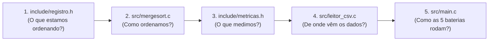
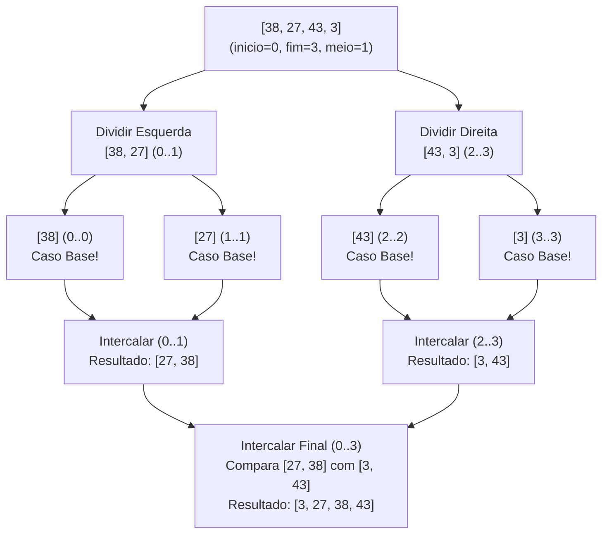

# Guia de Leitura, Estudo e Apresentação — Merge Sort Recursivo em C

> **Disciplina:** Estrutura de Dados — 4ª Fase de Ciência da Computação  
> **Objetivo deste Guia:** Preparar você e seu grupo para ler o código com fluidez, dominar toda a teoria exigida na 4ª fase e responder com segurança qualquer pergunta do professor durante a apresentação.

---

## Parte 1: Guia de Leitura do Projeto (Por Onde Começar?)

Para entender o projeto sem se confundir com detalhes de leitura de arquivos ou cronômetros logo de cara, leia os arquivos exatamente nesta ordem:

1. **`include/registro.h` e `src/registro.c` (5 min de leitura):**
   - Comece aqui. Veja o que é um `Registro` (uma linha da tabela do Excel) e como a função `comparar_registros(a, b)` decide quem vem antes.
2. **`include/mergesort.h` e `src/mergesort.c` (15 min de leitura — O Coração do Trabalho):**
   - Aqui estão apenas 3 funções principais:
     - `merge_sort()`: Aloca o vetor auxiliar `aux` na memória Heap uma única vez e dá a partida.
     - `merge_sort_recursivo()`: Divide o vetor ao meio repetidamente até sobrar 1 elemento.
     - `intercalar()`: Junta duas metades já ordenadas em uma única sequência ordenada.
3. **`include/metricas.h` e `src/metricas.c` (5 min de leitura):**
   - Veja como o cronômetro de alta precisão calcula o tempo em milissegundos (`ms`) e segundos (`s`).
4. **`src/leitor_csv.c` e `src/main.c` (10 min de leitura):**
   - Veja como o arquivo `.csv` exportado do Excel é carregado na memória para as quantidades `30`, `300`, `3.000`, `30.000` e `300.000`.

---

## Parte 2: Estudo Teórico e Prático (O que você precisa saber)

### 2.1. O Paradigma "Dividir e Conquistar" (Divide and Conquer)
O Merge Sort (criado por John von Neumann em 1945) resolve o problema da ordenação em **3 etapas**:

1. **Dividir (Divide):** Calcula o índice do meio do vetor (`meio = inicio + (fim - inicio) / 2`) e divide o problema em dois sub-vetores de metade do tamanho:
   - Metade Esquerda: `vetor[inicio .. meio]`
   - Metade Direita: `vetor[meio + 1 .. fim]`
2. **Conquistar (Conquer):** Chama o `merge_sort_recursivo` para ordenar a metade esquerda e depois a metade direita. A recursão para no **Caso Base** (`inicio >= fim`), isto é, quando o sub-vetor tem apenas **1 elemento** (pois um vetor de 1 elemento já está ordenado!).
3. **Combinar / Intercalar (Merge):** Usa a função `intercalar()` para fundir os dois sub-vetores ordenados em um único segmento ordenado.

---

### 2.2. Teste de Mesa Visual (Dry Run) — Para Desenhar no Quadro
Se o professor pedir para simular no quadro com 4 elementos `[38, 27, 43, 3]`, faça exatamente este desenho:

**Como funciona a intercalação final entre `[27, 38]` (índice `i`) e `[3, 43]` (índice `j`)?**
1. Compara `27` e `3` $\rightarrow$ `3` é menor $\rightarrow$ copia `3` para `aux[0]` e avança `j`.
2. Compara `27` e `43` $\rightarrow$ `27` é menor $\rightarrow$ copia `27` para `aux[1]` e avança `i`.
3. Compara `38` e `43` $\rightarrow$ `38` é menor $\rightarrow$ copia `38` para `aux[2]` e avança `i` (metade esquerda acabou!).
4. O laço final copia o que sobrou da direita (`43`) para `aux[3]`.
5. Copia `aux[0..3]` de volta para `vetor[0..3]`.

---

### 2.3. Análise de Complexidade (Matemática que o Professor Ama)

- **Relação de Recorrência:**
  $$T(n) = 2T\left(\frac{n}{2}\right) + O(n)$$
  *(Duas chamadas recursivas para metade do tamanho + tempo linear $O(n)$ para intercalar).*

- **Por que é $\Theta(n \log_2 n)$ em TODOS os casos?**
  - A árvore de recursão divide $n$ por 2 a cada nível até chegar a 1 elemento. Portanto, a altura da árvore é sempre $\log_2(n)$ níveis.
  - Em cada nível da árvore, a soma do trabalho de todas as chamadas de `intercalar()` percorre exatamente $n$ elementos.
  - Logo: $\text{Trabalho Total} = \text{Altura} \times \text{Trabalho por Nível} = n \log_2 n$.

| Caso | Complexidade de Tempo | Explicação Prática |
| :--- | :--- | :--- |
| **Melhor Caso** (Já ordenado) | $\Theta(n \log_2 n)$ | Mesmo ordenado, ele divide até 1 elemento e compara ao intercalar. |
| **Caso Médio** (Aleatório) | $\Theta(n \log_2 n)$ | Comportamento padrão da planilha do Excel. |
| **Pior Caso** (Inverso / Alternado) | $\Theta(n \log_2 n)$ | Ao contrário do Quick Sort (cujo pior caso cai para $O(n^2)$), o Merge Sort **nunca degrada**! |
| **Complexidade de Espaço** | $O(n)$ | Precisa de um vetor auxiliar `aux` de tamanho $n$ na Heap + $O(\log_2 n)$ na pilha de chamadas. |

---

### 2.4. O Crescimento Real de 30 até 300.000 Dados

Veja na tabela abaixo quantas operações ($n \log_2 n$) o Merge Sort faz em cada escala do nosso trabalho em comparação com um algoritmo quadrático ($n^2$ como o Bubble Sort):

| Quantidade ($N$) | $\approx \log_2(N)$ | Operações Merge Sort ($N \log_2 N$) | Operações Bubble Sort ($N^2$) |
| ---: | ---: | ---: | ---: |
| **30** | $4,9$ | $\approx 147$ | $900$ |
| **300** | $8,2$ | $\approx 2.468$ | $90.000$ |
| **3.000** | $11,5$ | $\approx 34.652$ | $9.000.000$ |
| **30.000** | $14,9$ | $\approx 446.179$ | $900.000.000$ |
| **300.000** | $18,2$ | $\approx 5.458.380$ | $90.000.000.000$ |

> [!TIP]
> **Frase de Efeito para a Apresentação:**
> *"Professor, repare que quando aumentamos a base de dados em **10 vezes** (de 30.000 para 300.000 registros), o tempo de execução do nosso Merge Sort aumentou apenas cerca de **12 vezes**, e não 100 vezes! Isso comprova na prática a complexidade $\Theta(n \log_2 n)$, pois $\frac{300.000 \log_2(300.000)}{30.000 \log_2(30.000)} = 10 \times \frac{18,19}{14,87} \approx 12,23$."*

---

## Parte 3: Explicação dos 4 Detalhes Técnicos Mais Importantes do Código C

1. **Por que calculamos `meio = inicio + (fim - inicio) / 2` em vez de `(inicio + fim) / 2`?**
   - Matematicamente são iguais. Porém, em C, um `int` de 32 bits suporta até `2.147.483.647`. Se `inicio` e `fim` forem grandes, a soma `inicio + fim` pode ultrapassar esse limite causando **Integer Overflow** (resultado negativo e crash). Subtrair `fim - inicio` primeiro evita esse estouro!
2. **Por que usamos `malloc()` na Heap e não declaramos `Registro vetor[300000]` na `main`?**
   - Variáveis locais ficam na **Stack (Pilha)**, que no Windows tem limite de apenas 1 MB a 2 MB. Um vetor de 300.000 estruturas ocupa dezenas de Megabytes e causaria **Stack Overflow**. Na **Heap** (`malloc`), podemos usar toda a memória RAM disponível do computador com segurança.
3. **Por que alocamos o vetor `aux` uma única vez em `merge_sort()`?**
   - Se chamássemos `malloc()` e `free()` dentro da função `intercalar()`, faríamos **299.999 alocações e liberações** ao ordenar 300.000 elementos, deixando o programa lento por culpa do sistema operacional. Alocando `aux` uma vez no começo e passando o ponteiro na recursão, medimos o tempo puro do algoritmo.
4. **Onde está a Estabilidade do Merge Sort no código?**
   - Na linha `if (comparar_registros(&vetor[i], &vetor[j]) <= 0)`. O sinal de **menor ou igual (`<=`)** garante que, se um elemento da esquerda empatar com um da direita, o da **esquerda entra primeiro**, mantendo a ordem original da planilha do Excel.

---

## Parte 4: Roteiro de Apresentação (5 a 10 Minutos)

Se a apresentação for dividida entre integrantes (ou feita individualmente), siga este roteiro cronometrado:

### Minuto 0:00 – 1:30 | Introdução e Arquitetura dos Dados (Excel $\rightarrow$ C)
- Apresente o objetivo: Ordenar cargas de **30, 300, 3.000, 30.000 e 300.000 registros** vindos do Excel usando Merge Sort Recursivo em C.
- Mostre o arquivo `include/registro.h` e explique como a `struct Registro` modela uma linha da planilha e como `comparar_registros()` desacopla os dados do algoritmo.

### Minuto 1:30 – 4:00 | Explicação do Código do Merge Sort Recursivo (`src/mergesort.c`)
- Abra `src/mergesort.c` e mostre as 3 funções:
  1. **A Fachada (`merge_sort`):** Mostre o `malloc` único do vetor auxiliar na Heap e explique o motivo (evitar Stack Overflow nos 300.000 dados).
  2. **A Recursão (`merge_sort_recursivo`):** Aponte o caso base (`if (inicio >= fim) return;`), o cálculo do `meio` e as duas chamadas recursivas (esquerda e direita).
  3. **A Intercalação (`intercalar`):** Aponte os 3 laços `while` (comparação entre esquerda e direita, sobra da esquerda, sobra da direita) e a cópia de volta para o vetor original.

### Minuto 4:00 – 6:30 | Demonstração ao Vivo e Análise dos Tempos
- Execute o programa ao vivo no terminal.
- Mostre a tabela gerada com as 5 quantidades (**30, 300, 3.000, 30.000 e 300.000**), destacando:
  - Como o cronômetro de alta precisão (`QueryPerformanceCounter`) consegue medir até os microssegundos da carga de 30 elementos.
  - A coluna de validação `[OK]` provando que `verificar_ordenacao()` checou todos os 300.000 itens.
  - A proporção de crescimento do tempo ($\approx 12\times$ a cada aumento de $10\times$ nos dados), comprovando a complexidade teórica $\Theta(n \log_2 n)$.

---

## Parte 5: Top 10 Perguntas de Professor na Defesa (e Como Responder)

1. **"Onde exatamente acontece a recursão no código de vocês?"**
   - *Resposta:* Dentro da função `merge_sort_recursivo()`, nas duas linhas onde ela chama a si mesma: primeiro para a metade esquerda `(inicio, meio)` e depois para a metade direita `(meio + 1, fim)`.
2. **"Qual é a condição de parada (caso base) da recursão? O que aconteceria sem ela?"**
   - *Resposta:* É `if (inicio >= fim) return;`, quando o sub-vetor tem apenas 1 elemento (ou nenhum). Sem ela, a função chamaria a si mesma infinitamente até estourar a pilha de execução (*Stack Overflow*).
3. **"Quantas vezes a função recursiva é chamada para 300.000 elementos?"**
   - *Resposta:* Como a árvore de chamadas do Merge Sort é uma árvore binária estritamente binária com $N$ folhas, o total de chamadas recursivas é sempre $2N - 1$. Para $N = 300.000$, são exatamente **599.999 chamadas**, mas a profundidade máxima simultânea na pilha é de apenas $\lceil \log_2(300.000) \rceil + 1 = 20$ níveis!
4. **"Por que há três laços `while` dentro da função `intercalar()`?"**
   - *Resposta:* O primeiro `while` compara elementos enquanto **ambas** as metades ainda têm itens. Quando uma das metades chega ao fim, ainda sobram elementos na outra metade (que já estão ordenados). Os outros dois `while` servem para copiar essas sobras (apenas um dos dois últimos `while` será executado a cada intercalação).
5. **"O que acontece com o tempo do Merge Sort se a tabela do Excel já vier 100% ordenada ou em ordem inversa?"**
   - *Resposta:* O tempo permanece $\Theta(n \log_2 n)$! O Merge Sort divide o vetor ao meio cegamente até chegar a 1 elemento em qualquer cenário. O número de movimentações é idêntico ($N \log_2 N$), mudando apenas ligeiramente o número de comparações na intercalação.
6. **"Como vocês garantem que os 300.000 dados realmente ficaram ordenados no final?"**
   - *Resposta:* Criamos a função `verificar_ordenacao()`, que percorre o vetor de `0` até `N-2` verificando se `vetor[i] <= vetor[i+1]`. Só imprimimos `[OK]` na tabela se nenhum par violar a ordem.
7. **"O tempo de abrir e ler o arquivo CSV do Excel está incluído no tempo exibido na tabela?"**
   - *Resposta:* Não! Nós carregamos o CSV para a memória RAM antes de ligar o cronômetro e paramos o cronômetro imediatamente após o `merge_sort()` terminar. Assim medimos apenas o algoritmo, sem interferência da velocidade do disco/SSD.
8. **"Por que não usaram `clock()` padrão da `<time.h>`?"**
   - *Resposta:* Porque no Windows o `clock()` tem resolução de ~15 ms. Como o C ordena 30, 300 e 3.000 elementos em menos de 1 milissegundo, `clock()` mostraria `0.000000 s`. Usamos o contador de alta resolução do hardware para ter precisão de microssegundos.
9. **"Como faço para inverter a ordenação de Crescente para Decrescente agora mesmo no código?"**
   - *Resposta:* Basta abrir `src/registro.c` na função `comparar_registros(a, b)` e inverter o sinal do retorno (ou trocar `a` por `b`). Não precisa mexer em nada no `mergesort.c`!
10. **"Qual é a principal desvantagem do Merge Sort?"**
    - *Resposta:* Ele não é *in-place*, ou seja, exige $O(n)$ de memória auxiliar extra (`aux`) proporcional ao tamanho do vetor original.
